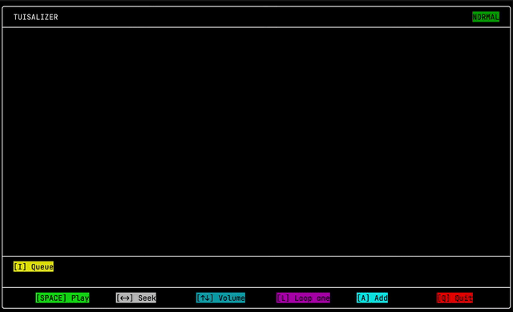

# Tuisalizer

A terminal-based music player written in C, featuring audio playback, queue management, and real-time audio visualization.

Tuisalizer combines SDL2 and FFmpeg for audio playback and decoding with a custom-built terminal UI library for rendering its interface.

## DEMO

<div align="center">

</div>

## Features

- **Audio playback** — Play and pause tracks, seek through songs, and adjust volume.
- **Queue management** — Navigate the playback queue and select upcoming tracks.
- **Real-time audio visualization** — Visualize the frequency spectrum of the currently playing audio using the Fast Fourier Transform (FFT).
- **Custom terminal UI** — Render the interface using [tui](https://github.com/Beginner10617/tui), a terminal UI library developed separately for reusable terminal rendering.
- **Colorful interface** — Unicode characters and ANSI colors for a more expressive terminal experience.
- **Track looping** — Toggle looping during playback.

## Controls

| Key | Action |
|:---:|---|
| `Space` | Play / Pause |
| `←` / `→` | Seek backward / forward |
| `↑` / `↓` | Adjust volume |
| `A` | Add tracks and playlists |
| `V` | Toggle visualizer |
| `L` | Toggle looping |
| `I` | Open queue |
| `Q` | Quit |

*Controls may vary depending on the current UI mode.*

## Mode system

The application uses mode system (like vim), following is a digram depicting mode transitions:
```
Normal mode- All keypresses shown on the layout will only work in this mode, to switch
│             back to this mode, press ESC
│             Available inputs : I, SPACE, Arror keys (all 4), L, A, Q
├────[I]──── A cursor appears on the queue window, which can be scrolled (left-right),
│            and used to chose another music in the queue
│             Available inputs : Left-right arrow keys, ENTER
├────[A]──── Add mode (opens a file-system window to choose music/playlist/lyrics file,
│            inferred from file name)
│             Available inputs : Up-down arrow keys, text-input, ENTER
╰────[Q]──── A window appear confirming to quit or not
              Available inputs : Left-right arrow keys, ENTER
```

## Dependencies

Tuisalizer uses the following libraries:

- [SDL2](https://www.libsdl.org/) — Audio output and playback support.
- [FFmpeg](https://ffmpeg.org/) — Audio decoding and resampling through `libavformat`, `libavcodec`, `libavutil`, and `libswresample`.
- [tui](https://github.com/Beginner10617/tui) — A custom terminal UI library used for rendering the interface.

A C compiler supporting C11 and the appropriate development headers and libraries are also required.

## Building

The current build script targets macOS and assumes SDL2 and FFmpeg are installed through Homebrew.

### Install dependencies

```bash
brew install sdl2 ffmpeg
```

The `tui` library is maintained in a separate repository. The current build script expects its headers and implementation to be available through your local development environment.

### Compile

From the project root, run:

```bash
chmod +x build.sh
./build.sh
```

The script compiles the application sources in `src/` and links against SDL2 and the required FFmpeg libraries using the local Homebrew installation paths.

Once compilation succeeds, run the resulting executable from the project directory:

```bash
./a.out
```

The output filename follows the compiler's default unless explicitly configured in `build.sh`.

**Note:** The build script currently uses machine-specific library paths. You may need to adjust these paths and configure the libraries separately when building on another machine.

## TODO

- Add lyrics support.

## Project Goals

Tuisalizer was built as a practical exploration of systems programming in C, audio processing, and real-time signal visualization. It brings these components together in an interactive music player that runs directly in the terminal.

The project also makes use of a reusable terminal UI library developed alongside the application, separating rendering functionality from music-player logic.

